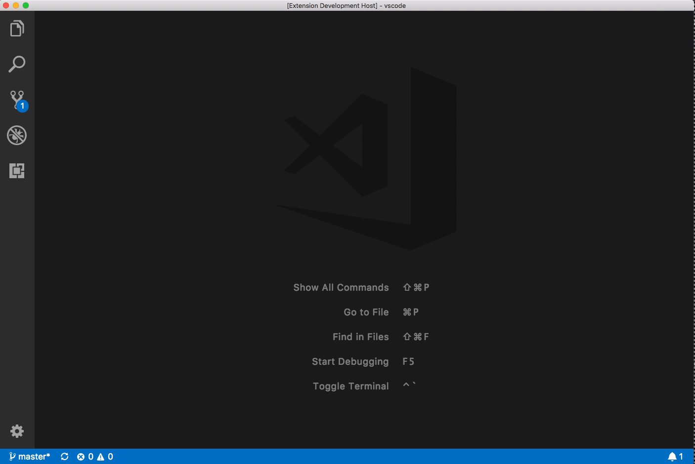

# Hello World ExTester

This is a Hello World example extension that shows you how to set up and run simple UI tests for VS Code extensions using the ExTester framework.

## Motivation

Our example extension gives us the ability to call the `Hello World` command, one that shows a notification saying `Hello World!`. We would like to write automated regression tests for this feature.



## Dependencies and Requirements

In order to run the ExTester, the extension needs these packages as dev dependencies:

- [`vscode-extension-tester`](https://www.npmjs.com/package/vscode-extension-tester) — the extension testing framework
- [`mocha`](https://www.npmjs.com/package/mocha) — required by ExTester for writing and running tests
- [`tsx`](https://www.npmjs.com/package/tsx) — optional, lets ExTester load the TypeScript tests directly, without compiling them first (ExTester 8.29.0+)

This example also uses `chai` as the assertion library, but any assertion package works.

> **Note:** The `test-resources` folder (where VS Code binaries, ChromeDriver, logs and screenshots are stored) is excluded from the TypeScript compiler and ESLint. Add it to your `.gitignore` as well.

---

## Running the Tests from the Terminal

```bash
npm install             # install dependencies
npm run ui-test         # download VS Code + package the extension + run tests
npm run ui-test:hidden  # the same, with a VS Code window that never shows up (experimental)
```

The `ui-test` script calls `extest setup-and-run` with no extra arguments — all options are read from [`extester.config.json`](./extester.config.json) at the project root.

### What happens under the hood

1. VS Code (`max` supported version) and ChromeDriver are downloaded into the test storage folder (`$TMPDIR/test-resources`, or the folder in the `TEST_RESOURCES` environment variable)
2. The extension is packaged and installed into the test VS Code instance; packaging runs `vscode:prepublish`, which compiles the extension to `out/`
3. Mocha runs the TypeScript test files matched by `./src/ui-test/*.test.ts`, which ExTester loads through `tsx` — there is no separate compile step for the tests

`tsx` only transpiles, it does not type-check. Run `npm run compile` (`tsc` + ESLint) to check the tests, as the CI workflow does before it runs them.

### Running with a hidden window (experimental)

With VS Code 1.147 or newer, `npm run ui-test:hidden` (`extest setup-and-run --hidden_window`) launches the test instance with a window that is never shown or focused, so you can keep working while the tests run. The same can be turned on with `"hiddenWindow": true` in the `run` section of `extester.config.json`, or with `EXTESTER_HIDDEN_WINDOW=true`.

VS Code then runs in extension test mode, which changes a few things a test can notice:

- **Dialogs are not shown.** VS Code answers them on its own, so [`modalDialog.test.ts`](./src/ui-test/modalDialog.test.ts) skips itself:

  ```typescript
  const dialogsShown = !VSBrowser.instance.isHiddenWindow;

  (dialogsShown ? describe : describe.skip)('Sample Modal Dialog Tests', () => { /* ... */ });
  ```

- **Opening a folder restarts VS Code.** `VSBrowser.instance.openResources()` handles that for you (as in [`treeView.test.ts`](./src/ui-test/treeView.test.ts)), but elements found before go stale.
- **Reloading the window ends the session.** Use `VSBrowser.instance.reloadWindow()` instead of running `Developer: Reload Window`; it works with both a visible and a hidden window.

The hidden window is meant for local runs; the CI workflow keeps the regular window. See [Running With a Hidden Window](https://redhat-developer.github.io/vscode-extension-tester/guides/hidden-window/) for every difference.

---

## Configuration (`extester.config.json`)

All ExTester options are centralised in [`extester.config.json`](./extester.config.json), shared by the `extest` CLI and the ExTester Runner extension:

```json
{
  "$schema": "./node_modules/vscode-extension-tester/resources/extester.schema.json",
  "setup": {
    "vscodeVersion": "max",
    "extensionsDir": ".test-extensions"
  },
  "run": {
    "testFiles": ["./src/ui-test/*.test.ts"],
    "settings": "./settings.json",
    "extensionsDir": ".test-extensions",
    "mochaConfig": "./.mocharc.js"
  },
  "runner": {
    "testFileGlob": "src/ui-test/**/*.test.ts",
    "ignorePathPart": "src/",
    "runSources": true
  }
}
```

- `setup` — download VS Code and ChromeDriver, package and install the extension
- `run` — run the tests; `testFiles` points at the TypeScript sources
- `runner` — read only by [ExTester Runner](#running-the-tests-from-vs-code-extester-runner); the CLI ignores it

The `$schema` field enables inline validation and autocomplete in VS Code. All path values are resolved relative to the config file's location.

CLI flags still work and always override the config file:

```bash
# run against a specific VS Code version instead of 'max'
npx extest setup-and-run --code_version 1.147.0
```

---

## Screenshots of Failures

ExTester takes a screenshot of every failed test, and (since 8.30.0) of every failed hook — `before`, `beforeEach`, `afterEach` and `after` — with Mocha's own hook functions, nothing to import. The screenshots are saved to `<test storage>/screenshots/<run-timestamp>/`.

The CI workflow sets `TEST_RESOURCES` to the runner's temp folder and uploads the screenshots, the VS Code logs and `chromedriver.log` as artifacts when a run fails.

---

## Global Setup and Teardown

ExTester starts VS Code in Mocha's global setup and shuts it down in the global teardown (8.30.0+). Your own fixtures go in the `globalSetup` and `globalTeardown` keys of a JavaScript `.mocharc` file; they run once per run, while the workbench is available:

```js
// .mocharc.js
module.exports = {
	timeout: 5000,
	// runs after VS Code has started, before the first test file
	globalSetup: async function () {
		this.server = await startMockServer();
	},
	// runs after the last test, before ExTester shuts VS Code down
	globalTeardown: async function () {
		await this.server.stop();
	},
};
```

This example does not need any, as each test file prepares its own state. Fixtures exported as `mochaGlobalSetup` / `mochaGlobalTeardown` from a module loaded with Mocha's `--require` are not supported. See [Global Setup and Teardown](https://redhat-developer.github.io/vscode-extension-tester/guides/global-setup-and-teardown/).

---

## Running the Tests from VS Code (ExTester Runner)

The [ExTester Runner](https://marketplace.visualstudio.com/items?itemName=redhat.extester-runner) extension (1.0.0+) adds the UI tests to VS Code's built-in **Testing** view.

### Setup

1. Install the **ExTester Runner** extension — the workspace recommends it in [`.vscode/extensions.json`](./.vscode/extensions.json)
2. Open this project in VS Code
3. Open the **Testing** view and expand **ExTester**

The Runner reads its project settings from the `runner` section of [`extester.config.json`](./extester.config.json), and the VS Code version from `setup.vscodeVersion`, so the project needs no `.vscode/settings.json`:

- `testFileGlob` — the test files listed in the Testing view
- `ignorePathPart` — hides `src/` from the folder labels, so the folder shows as `ui-test`
- `runSources` — runs the TypeScript sources through `tsx` instead of the compiled JavaScript in `out/`, so there is nothing to compile before a run

`.vscode/settings.json` is git-ignored: use it, or your user settings, for personal overrides. Workspace settings win over `extester.config.json`.

### Running and debugging tests

| Action | How |
|---|---|
| Run all tests, a folder or a file | Click ▶️ next to it in the **Testing** view |
| Run a single `describe` or `it` | Click ▶️ next to it in the **Testing** view or in the editor gutter |
| Debug a test | **Debug Test** in the **Testing** view or the gutter menu; breakpoints in the `.ts` tests stop, and Mocha's timeouts are turned off |
| Re-run the last run | **Test: Rerun Last Run** from the Command Palette |

Each test shows whether it passed, failed or was skipped. A failure shows the error, a diff of expected and actual values, a stack trace into the test code and a thumbnail of the failure screenshot. Tests marked with `.only` or `.skip` are labelled in the tree.

The **Screenshots** and **Logs** views below the tests keep the files of each run, newest first.

The [`Debug UI Tests`](./.vscode/launch.json) launch configuration remains available for debugging the whole suite from the **Run and Debug** view.

### Keeping the test window off your screen

These are personal VS Code settings, not project settings:

- `extesterRunner.hiddenWindow` — **experimental**, runs the tests with a [hidden window](#running-with-a-hidden-window-experimental) (VS Code 1.147+)
- `extesterRunner.virtualDisplay` — Linux only, runs the tests on an Xvfb virtual display that the Runner starts, without the hidden window's differences

See the [ExTester Runner guide](https://redhat-developer.github.io/vscode-extension-tester/guides/extester-runner/) for all settings.

---

## Test source layout

```
src/
└── ui-test/
    ├── activityBar.test.ts
    ├── bottomBar.test.ts
    ├── commands.test.ts
    └── ...
```

Tests are written in TypeScript and import from `vscode-extension-tester`:

```typescript
import { expect } from 'chai';
import { Workbench } from 'vscode-extension-tester';

describe('Hello World command', () => {
    it('shows a notification', async () => {
        const workbench = new Workbench();
        await workbench.executeCommand('Hello World');
        const notifications = await workbench.getNotifications();
        expect(notifications).not.to.be.empty;
    });
});
```

See the [ExTester documentation](https://redhat-developer.github.io/vscode-extension-tester/) for the full page object API reference.
